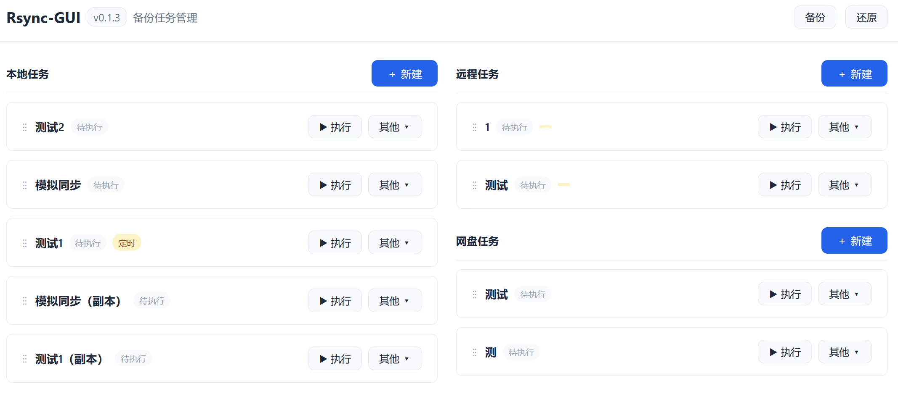

# Rsync-GUI

轻量级 Web 界面，管理 rsync / rclone 备份任务。

## 功能

- 创建、编辑、克隆、删除备份任务
- 三类任务：本地同步、SSH 远程同步、rclone 网盘同步
- 支持多个目标目录同步
- 定时执行（cron 表达式）
- WebSocket 实时日志推送
- 手动执行 / 强制停止
- 保存前预览 rsync 命令
- 演习模式（--dry-run），新建任务默认开启
- 排除规则（新建时默认填入 `.Trash-*` `.DS_Store`）
- 任务列表备份与还原（JSON 格式，同时导出/导入本地、远程和网盘任务）



## 快速开始

```bash
# 1. 安装依赖
uv sync
# uv sync -U # 安装最新版依赖（可能出兼容性问题）

# 2. 启动
uv run main.py
```

浏览器访问 `http://127.0.0.1:9765`。

程序以当前用户权限运行。如需访问所有文件，建议以 root 启动。

## 数据目录

首次运行会自动在运行目录下创建 `data/` 存放数据库和日志：

- `tasks.db` / `remote_tasks.db` / `rclone_tasks.db`：本地、远程、网盘三类任务配置
- `logs/`：执行日志

如需指定其他位置，设置环境变量 `RSYNC_GUI_DATA=/path/to/data`。

## 使用 Docker

使用 Docker Hub 镜像 `hansyou/rsync-gui:latest`（镜像构建方法见 [AGENTS.md](AGENTS.md)）。

### 运行容器

在项目根目录新建 `docker-compose.yml`：

```yaml
services:
    rsync-gui:
        image: hansyou/rsync-gui:latest
        container_name: rsync-gui
        ports:
            - "9765:9765"
        # environment:
        # 以下均为默认值
        # - RSYNC_GUI_DATA=/app/data
        # - RCLONE_CONFIG=/app/data/rclone.conf
        # - XDG_CACHE_HOME=/app/data/.cache
        volumes:
            #  防止时区错误
            - /etc/localtime:/etc/localtime:ro
            - /etc/timezone:/etc/timezone:ro
            - ./data:/app/data
            # 复用主机 ssh 配置，可选
            # - /home/admin/.ssh:/root/.ssh:ro
            # 复用宿主机已有 rclone 配置，可选
            # - ./dist/rclone.conf:/app/data/rclone.conf
            # 待备份目录
            # - /host/sources:/sources:ro
            # 备份目录:
            # - /host/backup:/backup
        restart: always
```

```bash
# 启动
docker compose up -d
# 浏览器访问 http://127.0.0.1:9765
```

`docker compose down`（加 -v 会同时删除数据卷），停止容器。

### 配置 rclone 网盘

rclone 的 remote 配置（`rclone.conf`）和缓存存放在数据卷内（`RCLONE_CONFIG` / `XDG_CACHE_HOME` 已指向 `/app/data`），首次使用前在容器内配置 remote：

```bash
docker exec -it rsync-gui rclone config
# 或复用宿主机已有配置: docker cp rclone.conf rsync-gui:/app/data/rclone.conf
```

### docker run

不想用 compose 时，直接用 docker run：

```bash
docker run -d \
  --name rsync-gui \
  -p 9765:9765 \
  -v /etc/localtime:/etc/localtime:ro \
  -v /etc/timezone:/etc/timezone:ro \
  -v $(pwd)/data:/app/data \
  # -v /home/admin/.ssh:/root/.ssh:ro \
  # -v $(pwd)/dist/rclone.conf:/app/data/rclone.conf \
  # -v /host/sources:/sources:ro \
  # -v /host/backup:/backup \
  --restart always \
  hansyou/rsync-gui:latest
```

## 开发与编译

开发环境搭建、打包单文件、Docker 镜像构建、发布清单等技术内容见 [AGENTS.md](AGENTS.md)。
